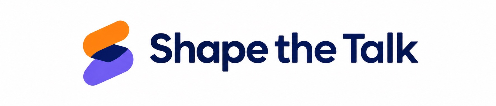
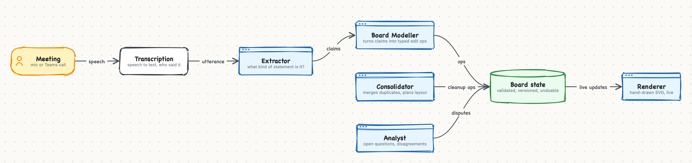

<p align="center">
  
</p>

<p align="center"><b>Your meeting draws its own whiteboard.</b><br>
Hackathon project by <b>Team SmartCat</b></p>

https://github.com/user-attachments/assets/291d32ab-9613-405d-ad08-bd685b26e63c

---

## The problem

Design meetings are spent talking about boxes and arrows that nobody draws. Someone shares a whiteboard and becomes
the scribe, falls behind and stops talking. Or nobody draws, and afterwards everyone remembers a different
architecture.

## What we built

Shape the Talk listens to the meeting and draws the diagram while people talk. When someone says *"no, it actually
goes through the queue first"*, the board redraws itself.

- **🎙 Talk live:** speak into your mic and watch the board build up as you talk.
- **👥 Teams meeting:** a bot joins a Microsoft Teams call, knows who said what and colours each change by speaker.
- **Corrections, not just notes:** "actually, no…" fixes the board in place, "scratch that" undoes, disagreements are
  marked as disputed until someone settles them.
- **A board that stays tidy:** background agents merge duplicates, group parts, and plan the layout so the story reads
  left to right.
- **You stay in control:** *Ask first* mode makes the AI ask before it removes anything.
- **After the meeting:** export PNG, JSON or Mermaid, the transcript and the open questions, generate a short spec,
  and read an auto-written meeting summary. Every meeting is recorded (`runs/`).
- **Bonus, in Claude Code:** the [`shapethetalk` plugin](claude-mod/shapethetalk/README.md) lets Claude draw the
  same hand-drawn diagrams live in a pane beside the conversation while it explains code.

## How it works

The key idea: **the AI never draws.** It edits a structured board through typed operations, and a deterministic
renderer draws it. That keeps the board stable, attributable and undoable.

<p align="center"><br>
<sub><i>Drawn by Claude with our own <code>shapethetalk</code> plugin.</i></sub></p>

Each statement becomes a set of ops tagged with who said it, so attribution can't be wrong and "undo" reverts exactly
one statement. Full details: [docs/ARCHITECTURE.md](docs/ARCHITECTURE.md).

**Built with:** Python, FastAPI and WebSockets · Claude Sonnet 5.5 (modeller, consolidator, analyst) · Jev classifier
(extractor) · OpenAI realtime transcription · Attendee (Teams bot) · vanilla JS, SVG and rough.js.

## Run it

```bash
uv sync                                   # Python 3.11+
cp .env.example .env                      # add ANTHROPIC_API_KEY, JEV_API_KEY, OPENAI_API_KEY
uv run uvicorn server:app --port 8010
```

Open http://localhost:8010, click **Start talking** and describe a system.

## Docs

| | |
|---|---|
| [docs/USAGE.md](docs/USAGE.md) | Modes, controls, exports, developer scripts and tests |
| [docs/TEAMS.md](docs/TEAMS.md) | Running the Teams bot (Attendee), breakout rooms, live captions, a fake Teams for testing |
| [docs/ARCHITECTURE.md](docs/ARCHITECTURE.md) | The agent pipeline, the board contract, layout, configuration, project layout, limitations |
| [docs/FINDINGS.md](docs/FINDINGS.md) | Model and transcription measurements, prompt-tuning history |
| [PLAN.md](PLAN.md) | The original hackathon plan |

## Team SmartCat

Emanuilo Jovanovic · Nikolina Trudić · Anđela Radojević · Filip Baturan
